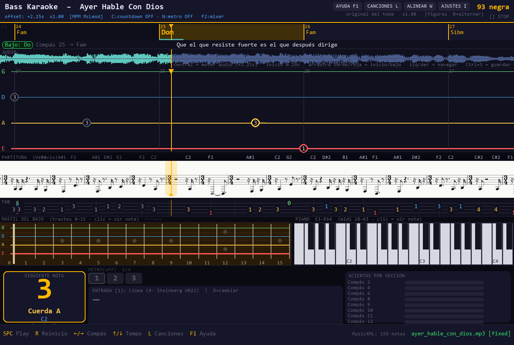

# Bass Karaoke

**Read this in:** **English** · [Español](README.es.md)

**Bass Karaoke** is an electric bass karaoke app with real-time scrolling
tablature, pitch detection and standard score display. Plug your bass into the
PC and the app tells you which note to play, when it sounds right and your
overall accuracy.

It includes songs such as *Feet Don't Fail Me Now* — Joy Crookes | Bass: Dayna
Fisher, plus jazz tunes generated from JJazzLab (*26-2*, *502 Blues*, *A Foggy
Day*, *Skylark*).



---

## Features

- **Scrolling tablature** with a guide line and current-note highlighting (it
  only lights up when the note *actually* sounds; rests leave nothing marked).
- **Real-time pitch detection** (aubio/MPM by default) with green/red feedback
  and a tuning panel (cents, sharp/flat).
- **Standard notation** rendered with Verovio + CairoSVG (bundled in the exe;
  Music21 can also be used as an alternative).
- **Alignment editor** with the MP3 waveform to adjust offset and tempo per song
  by ear.
- **Per-song tempo adjustment** (↑/↓): with varispeed the MP3 stretches/shrinks
  while keeping its pitch, and the bass and band are re-rendered at the new
  tempo so everything stays in sync (also for songs without an MP3).
- **Metronome, tuner and fretboard map** built in.
- **Track mixer** (`F2`): song (MP3), score bass line, band and metronome, each
  with its own volume and mute. The bass is synthesized offline and plays in
  sync with the MP3 (also with varispeed and seeking). With the *Bass SoundFont*
  feature it uses a real electric bass timbre; without it, it uses internal
  synthesis. The **band** (drums, piano and guitar) is generated offline with
  JJazzLab patterns and sounds if it is installed. If the song folder has a
  `<song>.mid`, that MIDI (all its channels) is rendered as the band instead of
  generating one.
- **Songs from JJazzLab** (`python -m bass_karaoke.sng <song>.sng`, or press
  `F7` directly on a `.sng` in `songs/`): generates `<song>.musicxml` +
  `<song>.chords.json`. By default the bass line is generated by **JJazzLab's
  own engine** (JJazzLab Toolkit, the app core without the UI): the `.sng` is
  converted to MIDI with the same exporter and the bass plays with its real
  swing, microtiming and velocities. Without Java 25 or the toolkit it falls
  back to the internal `yjz` generator (real phrases from the *jjSwing* style,
  variation per part —`rpVariationID`: Main A-1/B-1/C-1/D-1— and root
  transposition).
- **Standalone** single-file build (`dist/BassKaraoke.exe`) that installs
  optional features from the `I` menu itself.

---

## Requirements

- Python **3.10** (Windows)
- Bass connected to the PC: USB interface (Focusrite, Behringer…) or a cable to
  the microphone input (3.5 mm jack)
- Optional: **JJazzLab 5.x** installed (band with its patterns and SoundFont)
  and `tinysoundfont` (*Bass SoundFont* feature in the `I` menu). Without them
  the app still works, but the bass and band use internal synthesis.
- Optional: **Java 25** to generate a `.sng` MIDI with JJazzLab's real engine.
  The JRE installed by JJazzLab (`C:\Program Files\JJazzLab\jdk`) works, or any
  JDK 25 in `JAVA_HOME`/`PATH` (use the `JJAZZLAB_JAVA` variable to point to a
  specific one). The first time it downloads
  `vendor/jjazzlab-toolkit-5.2.1.jar` (21 MB, Maven Central); it is not
  versioned because it is LGPL. Without Java 25 the internal generator is used.

---

## Installation

Recommended — virtual environment with `uv`:

```bash
uv venv .venv --python 3.10
uv pip install --python .venv\Scripts\python.exe -r requirements.txt ^
   --find-links https://github.com/aubio/aubio/releases
```

Or with classic `pip`:

```bash
python -m venv .venv
.venv\Scripts\activate
pip install -r requirements.txt
```

> Note: `requirements.txt` asks for `aubio==0.5.0a0`, which is no longer on
> PyPI; if it fails, use `aubio==0.4.9` or install it with `--find-links` (see
> Troubleshooting). The app works without aubio, it only loses pitch detection.

---

## Running in development

```bash
.venv\Scripts\python.exe bass_karaoke_v3.py
```

or simply `python bass_karaoke_v3.py` (if the venv is activated).

Press **`L`** to choose a song and **`SPACE`** to start (4-3-2-1 countdown).

> The app reads its configuration from `bass_karaoke_config.json` (offsets,
> tempos and per-song settings). In the standalone it uses the one next to the
> exe.

---

## Songs

Each song lives in a subfolder of `songs/`:

```
songs/
  26-2/                    26-2.musicxml, 26-2.chords.json
  ayer_hable_con_dios/     <name>.musicxml, <name>.chords.json, <name>.mp3
  feet_dont_fail_me_now/   <name>.musicxml, <name>.tg, <name>.mp3
  skylark/                 <name>.musicxml
```

To add one:

1. Create `songs/<name>/`.
2. Add the `musicxml` (required). Optional: `.chords.json` (chord strip and
   band), `<name>.mid` (the band is rendered from that MIDI), `.mp3` (without an
   MP3 you practice with just the metronome/tablature) or a JJazzLab `.sng`
   (the app converts it with `F7`).
3. Press **`L`** in the app to open the song picker.

The MusicXML can be:

- A **TuxGuitar** export (notation + tablature with frets) — recommended.
- A **MuseScore** export with notation only: the app derives fret/string from
  each note's pitch (the tablature may differ from the original).

### Songs from JJazzLab

Copy the `.sng` to `songs/<name>/` and it will appear in the picker (`L`) as
pending generation: press **`F7`** and the app writes `<name>.musicxml` +
`<name>.chords.json` right there (without leaving the app). If the JJazzLab
engine is available it also writes:

- `<name>.mid`: the full MIDI exactly as exported by JJazzLab (drums, bass,
  chords…), without click or precount. If a `<name>.mid` that was not generated
  by the app already existed, it writes `<name>.jjazz.mid` instead so it is not
  overwritten.
- `<name>.jjazz.json`: marker with the bass channel and track. With it the app
  knows the `.mid` comes from the real engine, plays the bass from its own
  channel (exact swing and microtiming) and renders the band from the remaining
  channels, without duplicating the bass.

The tablature and score remain quantized to sixteenth notes (the app's model is
an integer grid); only the bass audio keeps real timing.

It can also be done from the terminal, for example in batch:

```bash
python -m bass_karaoke.sng JJazzLab-Jazz-1460\*.sng
```

- `--engine auto` (default): asks the JJazzLab engine for the MIDI; if it is not
  available it uses the internal generator. `--engine internal` forces the
  internal one.
- `--style yjz` (default): bass line with the real phrases from the *jjSwing*
  style when the internal generator is used; `walking`, `jjazz` and `two_feel`
  are the alternative internal generators.
- `--print` shows the chord symbols and the generated line; `--force`
  overwrites.
- It writes `<name>.musicxml` + `<name>.chords.json` (and `.mid`/`.jjazz.json`
  with the real engine). The band uses JJazzLab's patterns and SoundFont if it
  is installed (they are read from its installation, not redistributed).

### Song tempo

The original tempo is read from the **MusicXML tempo marks** (`<metronome>`),
not from the MP3. If there are no marks, 113 BPM is used by default. Add the
marks from MuseScore (Text → Tempo) and re-export. The app respects tempo
changes in the middle of a tune (scroll, metronome and synchronization follow
each section).

The `↑/↓` adjustment (stretching the MP3 slower/faster) is saved **per song**
with **`F5`**. In songs without an MP3 there is nothing to stretch: the bass and
band are regenerated at the chosen tempo and re-synchronized with the
tablature.

### If the bass does not start at the beginning of the MP3

In jazz and tunes with an intro the bass usually enters later (e.g. at 0:25).
Use the **MP3 offset**: `,`/`.` (0.05 s), `Shift+,`/`Shift+.` (0.5 s) or
`Ctrl+,`/`Ctrl+.` (5 s) to delay the MP3 entry until bar 1 matches the bass.
The offset is saved **per song** with **`F5`**.

### Alignment editor (`W`)

When the tempo or the bass entry does not match the score (typical in jazz,
where the soloist stretches a bar), press **`W`** to see the **MP3 waveform**
and align it visually:

- **Red line = FIRST bass note** (offset): drag it to move it.
- **Click** on the waveform: moves only the white cursor.
- **Green marks = tempo changes** (with their BPM): they open where the score
  says; drag them to where they **actually sound** and they stay fixed there.
- **`R`**: resets all marks to what the score says (the red line is kept).
- **Right click**: adds a tempo mark (inherits the current BPM).
- **Wheel**: time zoom on the waveform. **Middle click + drag**: horizontal pan.
- **`SPACE`**: plays/pauses the MP3 at natural speed from the cursor.
- **`F`**: indicative librosa analysis (average tempo + onsets).
- **`↑`/`↓`**: raises/lowers the BPM of the section under the cursor.
- **`←`/`→`**: moves the cursor (±1 s, ±5 s with `Ctrl`).
- **`Del`**: deletes the tempo mark of the active section.
- **`W`/`ESC`**: saves and closes (offset + per-song tempo map).

The waveform also draws the green band (transcribed region), bar ticks, score
sections (yellow) and MusicXML references (cyan) when you have moved a mark.
Everything is saved per song in the config.

---

## Controls

| Key | Action |
|---|---|
| `SPACE` | Play / pause (with 4-3-2-1 countdown) |
| `L` | Song picker |
| `W` | Alignment editor (MP3 waveform) |
| `C` | Enable/disable countdown |
| `R` | Restart |
| `← / →` | Previous / next bar |
| `↑ / ↓` | Tempo ±5 BPM (with varispeed it stretches the MP3) |
| `, / .` | MP3 offset ±0.05 s (fine) |
| `Shift + , / .` | Offset ±0.5 s (medium) |
| `Ctrl + , / .` | Offset ±5 s (fast) |
| `D` | Audio device picker (if input is available) |
| `P` | Pitch method picker |
| `S` | Switch score renderer (Verovio ↔ Music21) |
| `M` | Mute MP3 |
| `F2` | Mixer: song / bass / band / metronome (↑/↓ track, ←/→ volume, `M` mute) |
| `F7` | Generate the missing score (from the song's audio or `.sng`) |
| `F8` | 3/4 ↔ 4/4 time signature when generating from audio |
| `N` | Metronome sound |
| `T` | Tuner |
| `H` | Fretboard map |
| `B` | Toggle tempo display (BPM ↔ note value) |
| `I` | Optional features menu (standalone only) |
| `F5` | Save configuration |
| `F6` | Load configuration |
| `F1` | Help (all shortcuts) |
| `ESC` | Quit |

---

## How it works

- The tablature scrolls from right to left; the vertical golden line marks the
  note you should play now.
- The large number in the left panel shows the fret to press.
- String colors: E=red, A=yellow, D=blue, G=green.

**Current-note colors:**
- **Yellow** — waiting for your input
- **Green** — correct (you played the note right)
- **Red** — wrong note

**Pitch panel (right):** shows the note you are playing in real time. The
horizontal bar indicates whether you are sharp/flat. The % is the overall
accuracy.

---

## Standalone (Windows)

Build a **single exe** with all dependencies (PyInstaller):

```powershell
.\build.ps1                # normal build
.\build.ps1 -Verify        # build + auto-check of the exe (BK_VERIFY=1)
```

Manual equivalent:

```powershell
.venv\Scripts\python.exe -m pip install pyinstaller
.venv\Scripts\pyinstaller.exe build_basic.spec --clean --noconfirm
```

The result is `dist/BassKaraoke.exe` (~50 MB). To deploy it on another PC:

1. Copy the exe together with the **`songs/`** and **`models/`** folders (they
   are not packaged so you can add songs without recompiling). The `assets/`
   folder is inside the exe (including the `TimGM6mb.sf2` SoundFont).
2. Optional features (torch/crepe, pesto, varispeed, etc.) are installed from
   the **`I`** menu and stored in `./features` next to the exe; restart the app
   after installing them.

The build bundles by default (they are no longer optional):

- **verovio + cairosvg** with the cairo DLLs from GTK2-Runtime (works on any PC
  without installing them system-wide).
- **soundfile**: MP3 decoding for the alignment editor waveform.

Technical details are in the header of `build_basic.spec`.

---

## Project structure

```
bass_karaoke/      → main package (app, audio, score, ui…)
bass_karaoke_v3.py → development entry point
launcher.py        → exe entry point (BK_VERIFY=1 mode for auto-check)
build_basic.spec   → PyInstaller spec for the basic standalone
build.ps1          → build script
models/            → pitch detection models (ONNX)
assets/            → static resources (screenshot, GM SoundFont, etc.)
songs/             → songs (each one in its own subfolder)
tests/             → pitch detector test scripts
scripts/           → utilities (list audio devices, etc.)
requirements.txt
```

---

## Troubleshooting

**`No module named aubio`**
→ `pip install aubio --find-links https://github.com/aubio/aubio/releases`
→ If it fails, the app keeps working, just without pitch recognition.

**`PortAudio library not found`**
→ `pip install sounddevice --upgrade`
→ Or reinstall: `pip install pipwin && pipwin install pyaudio`

**`Bass not detected`** (the microphone does not pick up the bass)
→ Check that your interface appears as an input device in Windows
→ Raise the input volume in the Windows mixer
→ Use the **`D`** key to choose the correct device

**The band sounds like a synth and has no drums**
→ Install **JJazzLab** (the band reads its patterns and SoundFont) and the
*Bass SoundFont* feature from the **`I`** menu, then restart.
→ Without JJazzLab, a `<song>.mid` next to the musicxml also works as the band.

**The score does not render in the standalone**
→ The cairo DLLs are taken from the GTK2-Runtime of the build machine. If they
fail on the target PC, reinstall the GTK2-Runtime and rebuild, or point the
`GTK2_RUNTIME_BIN` variable to its `bin` folder before `build.ps1`.

---

Original tablature: [www.basslessons.be](https://www.basslessons.be)
